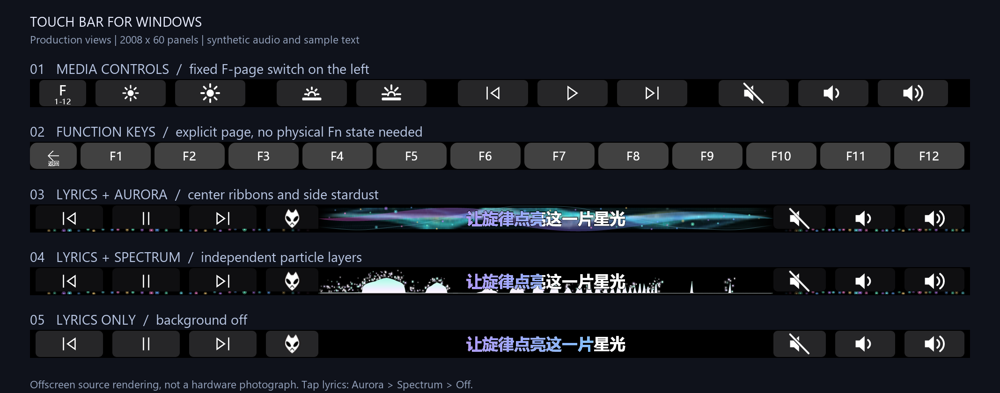
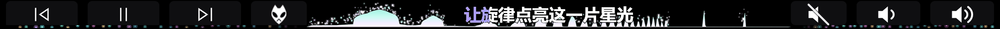
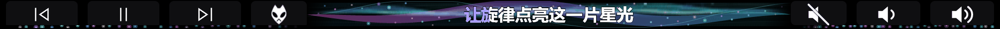

# Touch Bar for Windows

**Media controls, F1–F12, synchronized lyrics and music visualization on an Apple Touch Bar running Windows.**

[简体中文](README.md) · **English**

[](https://github.com/LOVEgithub12/touchbar/actions/workflows/checks.yml)


A personally maintained project for Apple T2 MacBooks. The current transport uses **usbipd-win and a local C# USB/IP client** for display and touch, with the app running as a normal desktop user. Hardware validation has been performed on a **MacBookPro16,1 running Windows 10 22H2 with a 2008 × 60 panel**.

This repository distributes **source code, required scripts, tests and documentation**. It does not include compiled installers, driver packages, songs, reference videos or personal runtime records. This is not an official Apple project.

## Previews



**Live spectrum and layered particles · complete Touch Bar**



**Enlarged center detail · particle dwell, scatter and fade**


**Aurora ribbons · an alternative selectable background**



These are **offscreen renders of the current production views and renderers**, driven by synthetic audio and sample text. They are not hardware photographs and contain no personal music. Full panels retain the native 2008 × 60 aspect ratio; click an image to inspect the original. Hardware brightness, viewing distance and the GIF's 20 fps affect the perceived result. See [Development](docs/DEVELOPMENT.md#效果图复现--reproducing-the-previews) for reproduction steps.

## Features

| Feature | Current behavior |
|---|---|
| Media controls | Previous, play/pause, next, volume and mute; hold to repeat volume adjustments |
| F1–F12 | Fixed **F / 1–12** button on the left of the media bar; explicit page selection and a left-side return button, independent of physical Fn state inference |
| Display brightness | Windows brightness interface and native OSD, dependent on WMI/Boot Camp support |
| Keyboard backlight | Apple HID adjustment with no additional popup |
| Synchronized lyrics | foobar2000 + foobox/JSplitter bridge, local LRC and embedded lyrics, single-line purple/blue karaoke highlighting |
| Long and multilingual lyrics | 34 px text, reduced to 28 px if needed, then smooth scrolling; Chinese, English, Japanese and Korean font fallback |
| Two music backgrounds | Aurora ribbons / live spectrum; tap the lyric area to cycle **Aurora → Spectrum → Off**, with persistent selection |
| Live spectrum | 512 logarithmic bands with separate bass, midrange and treble response; independent particle layers dwell, fall and fade; this update increases vertical spread and visibility in the right half |
| Side stardust | Both backgrounds retain side pulses and edge blending; slightly shorter lyric-page button backgrounds expose more light below |
| Automatic pages | Active playback retains the media/lyric page; configured foreground browser shortcuts become available after pausing |
| Temporary main bar | Tap the player icon to open the main bar; return to lyrics after four idle seconds from the last touch release, never while a finger is held |
| Application shortcuts | Per-process buttons in `settings.json`, including Edge/Chrome examples and Explorer dialog support |
| Startup recovery | Login startup, device readiness waits, retries and cancellation; a separate boot recovery tool targets a confirmed VBoxUSB Code 37 failure |

See [Usage and features](docs/USAGE.en.md).

## Quick start

Requirements: Windows x64, compatible Apple Touch Bar and Boot Camp device support, PowerShell 7, **.NET 6 SDK** and official **usbipd-win 5.3.0**. .NET 6 has reached upstream end of support; it remains the current target and migration is pending. Layouts are also checked at 2170 pixels wide; this does not establish compatibility with every T2 model.

```powershell
git clone https://github.com/LOVEgithub12/touchbar.git
cd touchbar

# Restore NuGet dependencies, build and prepare the launcher runtime directory
pwsh -NoProfile -File .\tools\Build.ps1 -PrepareRuntime
```

If the SDK is not on PATH:

```powershell
pwsh -NoProfile -File .\tools\Build.ps1 `
  -DotNetPath "$env:LOCALAPPDATA\Microsoft\dotnet\dotnet.exe" -PrepareRuntime
```

Then configure the USB/IP transport using the [installation guide](docs/INSTALL.en.md). **Building a fresh clone alone does not initialize the hardware.** The guide covers driver binding, the lyrics bridge, startup and restoring the Apple driver. The current USB/IP route keeps Secure Boot enabled and requires neither test signing, the historical DFRDisplayKm driver nor WSL.

After device setup, launch from a normal desktop-user session:

```powershell
.\Start-Media.cmd       # Media controls
.\Start-Functions.cmd   # F1–F12 page
.\Stop.cmd              # Stop the app and cancel pending startup
```

To update an existing installation, run `Stop.cmd`, build with `-PrepareRuntime`, then start again. The build helper preserves an existing `settings.json` and does not change driver bindings, the lyrics bridge or startup configuration.

## Documentation

| Document | Contents |
|---|---|
| [Installation](docs/INSTALL.en.md) / [中文](docs/INSTALL.md) | Requirements, building, USB/IP, foobar2000, login startup, restoring Apple |
| [Usage and features](docs/USAGE.en.md) / [中文](docs/USAGE.md) | Pages, lyrics, backgrounds, application shortcuts and troubleshooting |
| [Development](docs/DEVELOPMENT.md) | Architecture, offline checks, reproducible previews and hardware acceptance limits; bilingual |
| [Changelog](CHANGELOG.md) | Features and fixes in this update; bilingual |
| [Contributing](CONTRIBUTING.md) | Issue reports, changes and validation; bilingual |
| [Third-party notices](THIRD_PARTY_NOTICES.md) | Origins, licenses and scope of permissions; bilingual |

## Scope and limitations

- Lyrics integrate specifically with **foobar2000 + foobox/JSplitter**, rather than every music player. There is no online lyric search or download. Untimed text cannot provide accurate word synchronization.
- Audio comes from **WASAPI shared-output loopback**: the endpoint mix, rather than isolated vocals. Other applications can contribute sound. ASIO / WASAPI exclusive output may not be captured. No microphone is recorded and no PCM is saved.
- Ordinary shortcuts remain subject to Windows UIPI. Standalone volume/mute now use Shell system commands and have been verified with elevated Task Manager in the foreground.
- Native brightness OSD, keyboard backlight and the three hardware Touch Bar backlight states depend on the hardware and Boot Camp environment. Equivalent Windows 11 or other-model behavior is not established.
- The latest startup fixes have offline and login-entry validation, but **another full hardware reboot remains to be tested after those fixes**. Automated checks do not replace hardware, suspend/resume and reboot acceptance.

## Source layout

```text
WindowsTouchBar-master/WindowsTouchBar/  C# app, views, lyrics, audio and USB/IP
TouchBar-USBIP/                        Launch, stop, diagnostics and startup
tools/Build.ps1 · Check.ps1            Build, runtime preparation, offline checks
tools/LyricsResearch/                 foobar2000 bridge and reference material
tests/                                Layout, touch, spectrum, lyrics and startup checks
docs/                                 Chinese/English guides and public previews
DFRDisplayKm-master/                   Historical driver reference, not current setup
```

Earlier transport experiments and research remain in the repository. New users should follow this README and `docs/`; historical WinUSB, WSL and DFRDisplayKm workflows are not the current setup.

## Credits and licensing

Thanks to the authors of WindowsTouchBar, DFRDisplayKm, usbipd-win, NAudio, SkiaSharp, lyricbar and the other dependencies. Components retain their own licenses. There is currently **no single license declaration covering all source origins in this repository**; read [Third-party notices](THIRD_PARTY_NOTICES.md) before treating the entire repository as MIT-licensed. Apple, Windows, foobar2000 and their icons remain the property of their respective rights holders.
