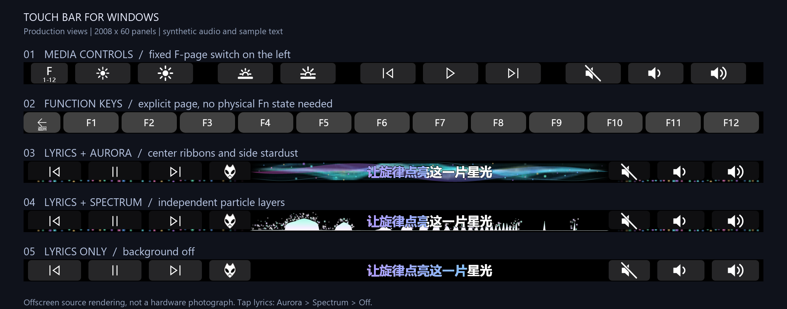
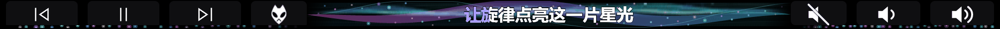

# Touch Bar for Windows

**在 Windows 上使用 Apple Touch Bar：媒体控制、F1–F12、同步歌词与音乐可视化。**

**简体中文** · [English](README.en.md)

[](https://github.com/LOVEgithub12/touchbar/actions/workflows/checks.yml)


这是面向 Apple T2 MacBook 的个人维护项目。当前使用 **usbipd-win + 本机 C# USB/IP 客户端**驱动 Touch Bar 的显示与触摸，应用以普通桌面用户运行。已在 **MacBookPro16,1 / Windows 10 22H2 / 2008 × 60** 面板上实机验证。

本仓库发布**源码、必要脚本、测试和文档**，可自行构建；不包含预编译安装包、驱动安装文件、歌曲、参考视频或个人运行记录。它不是 Apple 官方项目。

## 效果预览



**实时频谱与分层粒子 · 完整 Touch Bar**


**中区局部放大 · 便于观察悬停、散落与淡出的粒子**


**极光绸带 · 另一种可切换背景**



这些图片由**当前生产视图和渲染器离屏绘制**，采用合成音频输入与演示文字，不是实物拍摄，也不使用个人歌曲。完整栏保持 2008 × 60 原始比例；GitHub 会缩小显示，可点击图片查看原图。实机亮度、观看距离与 GIF 的 20 fps 会影响观感。生成方法见[开发说明](docs/DEVELOPMENT.md#效果图复现--reproducing-the-previews)。

## 功能

| 功能 | 当前行为 |
|---|---|
| 媒体控制 | 上一首、播放/暂停、下一首；音量增减与静音，支持按住连发 |
| F1–F12 | 媒体栏左侧固定 **F / 1–12** 入口；点击显式切换，F 页左侧返回，不依赖物理 Fn 的状态推断 |
| 屏幕亮度 | 使用 Windows 亮度接口与原生 OSD；依赖设备 WMI/Boot Camp 支持 |
| 键盘背光 | Apple HID 调节，静默操作，不额外弹出提示 |
| 同步歌词 | foobar2000 + foobox/JSplitter 桥接；本地 LRC、内嵌歌词，单行卡拉 OK 紫蓝着色 |
| 长歌词与多语言 | 优先使用 34 px 字体，必要时缩到 28 px，再平滑滚动；中、英、日、韩混排字体回退 |
| 两种音乐背景 | 极光绸带 / 实时频谱；点击歌词按 **极光 → 频谱 → 关闭** 循环，选择会保存 |
| 实时频谱 | 512 个对数频带，区分低、中、高频；多层粒子独立悬停、下落和淡出；最新版本提高右半区粒子的纵向分布与可见度 |
| 两侧星尘 | 两种背景均保留两侧星尘脉动与边缘过渡，歌词页按钮背景底部略收窄，让下方光效更明显 |
| 自动切页 | 播放时保留媒体/歌词页；暂停后，前台浏览器等已配置应用可显示专属快捷栏 |
| 临时主栏 | 点击歌词页的播放器图标回主栏，最后一次触摸释放后空闲 4 秒回歌词；按住时不跳页 |
| 应用快捷栏 | 在 `settings.json` 中按前台进程配置按钮；附带 Edge、Chrome 示例和 Explorer 对话框支持 |
| 启动恢复 | 登录启动、等待设备就绪、失败重试、可取消启动；提供针对已确认 VBoxUSB Code 37 故障的独立开机恢复工具 |

详见[功能与操作](docs/USAGE.md)。

## 快速开始

需要 Windows x64、兼容的 Apple Touch Bar、Boot Camp 相关设备支持、PowerShell 7、**.NET 6 SDK** 和官方 **usbipd-win 5.3.0**。`.NET 6` 已结束上游支持；这是当前代码的目标框架，升级尚未完成。布局也检查了 2170 像素宽度，但不代表所有 T2 机型均已实测。

```powershell
git clone https://github.com/LOVEgithub12/touchbar.git
cd touchbar

# 恢复 NuGet 依赖、构建，并准备启动脚本需要的 app 目录
pwsh -NoProfile -File .\tools\Build.ps1 -PrepareRuntime
```

如果 SDK 未在 PATH 中：

```powershell
pwsh -NoProfile -File .\tools\Build.ps1 `
  -DotNetPath "$env:LOCALAPPDATA\Microsoft\dotnet\dotnet.exe" -PrepareRuntime
```

接着按[安装指南](docs/INSTALL.md)安装并绑定 USB/IP 传输；**首次克隆只完成构建还不能直接点亮设备**。该指南说明驱动配置、歌词桥接、自启动和恢复 Apple 驱动的方法。当前 USB/IP 路线保持 Secure Boot 开启，无需启用测试签名或安装仓库内的旧 DFRDisplayKm 驱动，也不需要 WSL。

已完成设备配置后，在普通桌面用户会话中运行：

```powershell
.\Start-Media.cmd       # 媒体栏
.\Start-Functions.cmd   # F1–F12 页
.\Stop.cmd              # 停止，并取消等待中的启动
```

更新已有安装时，先 `Stop.cmd`，再构建 `-PrepareRuntime`，最后重新启动。构建助手保留现有 `settings.json`，不主动修改设备驱动、歌词桥接或自启动配置。

## 文档导航

| 文档 | 内容 |
|---|---|
| [安装指南](docs/INSTALL.md) / [English](docs/INSTALL.en.md) | 环境、构建、USB/IP、foobar2000、登录启动、恢复原驱动 |
| [功能与操作](docs/USAGE.md) / [English](docs/USAGE.en.md) | 页切换、歌词、背景、快捷栏、故障排查 |
| [开发说明 / Development](docs/DEVELOPMENT.md) | 架构、离线测试、效果图复现、实机验收边界（中英双语） |
| [更新记录 / Changelog](CHANGELOG.md) | 本次功能与修复（中英双语） |
| [贡献指南 / Contributing](CONTRIBUTING.md) | 提交问题、修改和验证要求（中英双语） |
| [第三方与授权 / Notices](THIRD_PARTY_NOTICES.md) | 来源、许可证和授权范围说明（中英双语） |

## 范围与限制

- 歌词专门对接 **foobar2000 + foobox/JSplitter**，不是所有播放器通用方案；不在线搜索或下载歌词。无时间轴的文本不能提供准确逐字同步。
- 音频来自 **WASAPI 共享输出回环**，反映该输出端点的混音，而非分离的人声；其他程序声音也可能参与。ASIO / WASAPI 独占输出不能保证捕获。程序不录制麦克风，也不保存 PCM。
- 普通快捷键仍受 Windows UIPI 限制；单独的音量/静音命令已改用 Shell 系统命令，实测在管理员任务管理器前台仍可使用。
- 原生亮度 OSD、键盘背光和三档 Touch Bar 背光依赖具体硬件及 Boot Camp 环境，不能保证 Windows 11 或其他机型具有相同行为。
- 最新启动修复已有离线与登录入口验证，**修复后的整机重启链路仍待再次实机验收**。自动化检查不能代替真实设备、睡眠唤醒和重启测试。

## 源码结构

```text
WindowsTouchBar-master/WindowsTouchBar/  C# 应用、视图、歌词、音频、USB/IP
TouchBar-USBIP/                        日常启动、停止、检查与自启动脚本
tools/Build.ps1 · Check.ps1            构建、准备运行目录与离线回归入口
tools/LyricsResearch/                 foobar2000 桥接及参考资料
tests/                                布局、触摸、频谱、歌词和启动回归
docs/                                 中英文文档及公开效果图
DFRDisplayKm-master/                   历史驱动参考，非当前安装路径
```

仓库保留了早期传输探索和研究资料。新用户以本首页和 `docs/` 为准；历史 WinUSB、WSL、DFRDisplayKm 路线不是当前推荐流程。

## 致谢与授权

感谢 WindowsTouchBar、DFRDisplayKm、usbipd-win、NAudio、SkiaSharp、lyricbar 及其他依赖的作者。各组件保留自身许可证；仓库目前**没有覆盖所有来源文件的统一许可证声明**，请阅读[第三方与授权说明](THIRD_PARTY_NOTICES.md)，不要将整仓库视为统一 MIT 授权。Apple、Windows、foobar2000 等名称与图标属于各自权利人。
